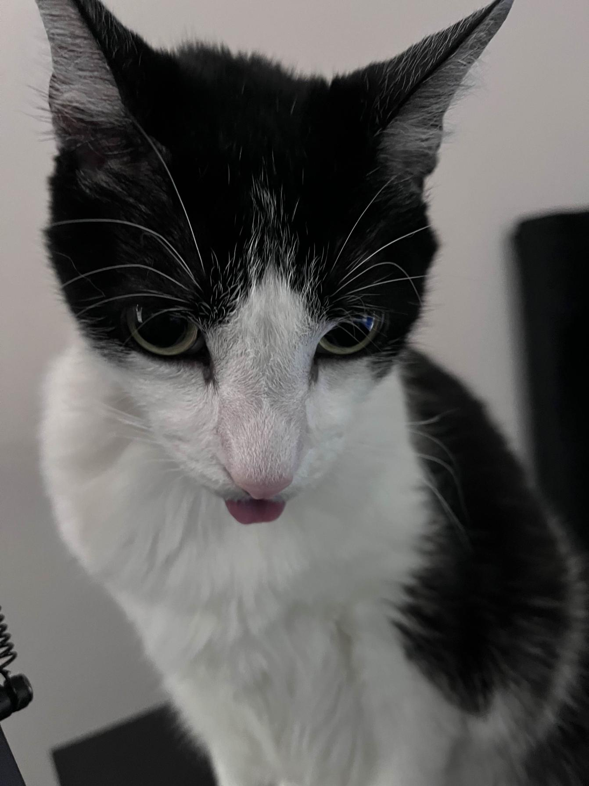

# skatboards

## about me

hii im natalie ! a comp sci student at UCF on the KnightHacks workshop team. we research, design, plan, and present workshops to 100s of students each semester. im also apart of the BNY intern program working on infrastructure demands of ai-powered apps.  

i looove helping teach others things ! teaching is the best form of mastery and has been a big motivation for me in the field of computer science. being able to understand what tools go where and how/when to use them has become a huge part of modern development. if you're ever curious about some of my work, please connect !! 

  
<h2> currently </h2>
- planning workshops  
- being an  academic weapon  🤓  
- working on projects  
- losing sleep over deployment  

  connect w/ me ! 
  <a href="mailto:natrse@icloud.com">email</a> | <a href="www.linkedin.com/in/nat-reese">linkedin/nat-reese</a>   
  pfp - <a href="https://www.pixiv.net/en/users/36087924">GreedyDeviant</a>
  

---

  
p.s look at my cat his name is snoopy  

